# Modelo entidad-relación - SIGM Cloud

El modelo se organiza en trece módulos funcionales sobre un esquema único (`sigm`). Todas las tablas de negocio incluyen `tenant_id` y las relaciones usan claves foráneas compuestas `(tenant_id, id)`, de modo que el motor impide referencias entre tenants incluso si la aplicación cometiera un error.

## Mapa de módulos

| # | Módulo | Migración | Tablas |
| --- | --- | --- | --- |
| 1 | Tenancy y suscripciones | 002 | 8 |
| 2 | Organización y recursos | 003 | 5 |
| 3 | Identidad y acceso | 004 | 8 |
| 4 | Especialidades y profesionales | 005 | 7 |
| 5 | Pacientes | 006 | 10 |
| 6 | Catálogos clínicos | 007 | 7 |
| 7 | Agendamiento | 008 | 9 |
| 8 | Historia clínica | 009 | 15 |
| 9 | Documentos | 010 | 4 |
| 10 | Laboratorio | 011 | 4 |
| 11 | Facturación y EPS | 012 | 13 |
| 12 | Interoperabilidad | 013 | 5 |
| 13 | Auditoría y seguridad | 014 | 3 |
| | **Total** | | **98** |

## 1. Tenancy y suscripciones

`tenants` es la raíz de aislamiento. Todo dato clínico o administrativo cuelga, directa o indirectamente, de un tenant. `plans` es un catálogo global; `tenant_subscriptions` y `subscription_payments` registran la relación comercial.

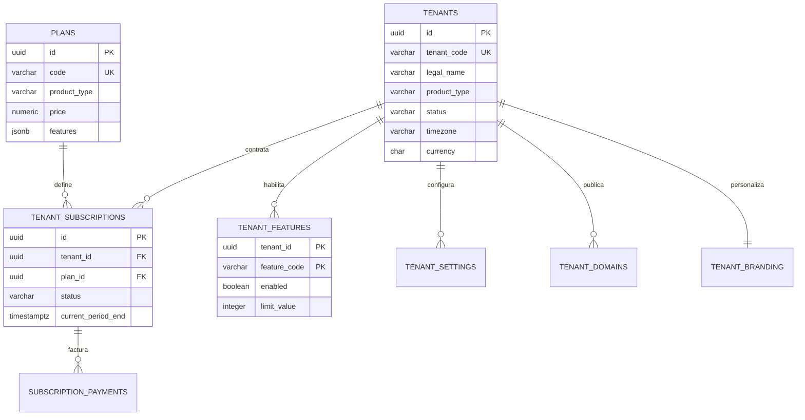

Reglas destacadas:

- Un tenant solo puede tener una suscripción vigente (`TRIAL`, `ACTIVE`, `PAST_DUE`), garantizada por índice único parcial.
- `product_type` distingue `CLINIC` y `PRACTICE`; los planes pueden aplicar a uno o a ambos.
- `tenant_features` permite vender módulos sin duplicar el modelo.

## 2. Organización y recursos

Un tenant puede agrupar varias organizaciones legales. Las sedes (`sites`) pertenecen a una organización; los consultorios (`medical_offices`) y recursos reservables (`resources`) pertenecen a una sede.

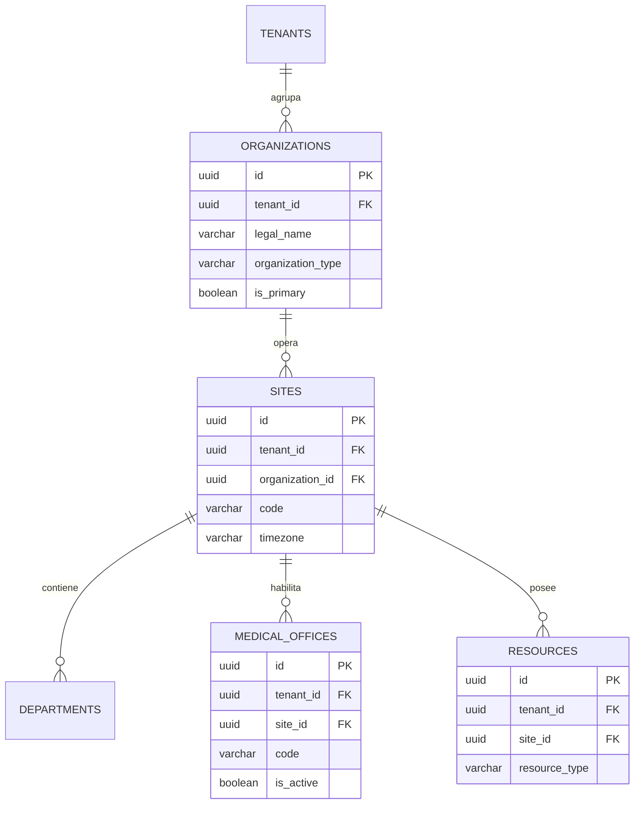

## 3. Identidad y acceso

`users` es una identidad global (un correo, una persona) que puede pertenecer a varios tenants mediante `user_tenants`. Los roles son globales (`tenant_id NULL`) o propios de un tenant. Los permisos son un catálogo global y se asignan a roles.

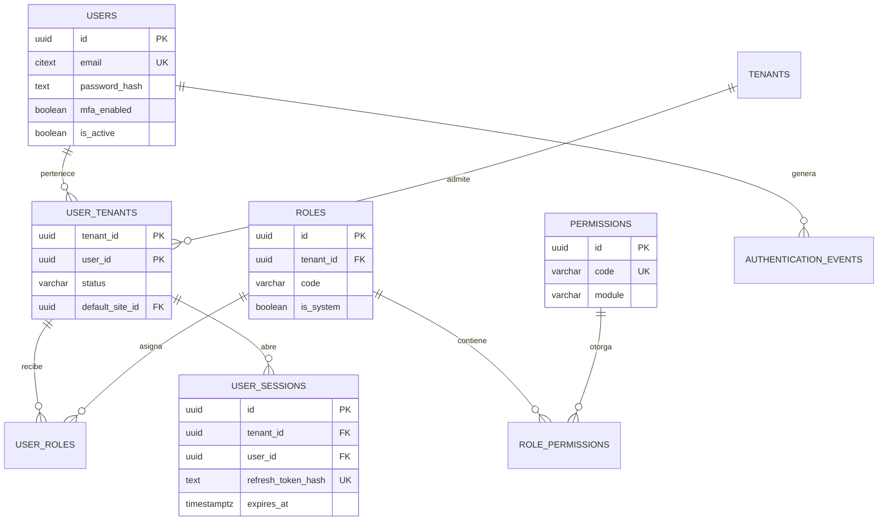

Reglas destacadas:

- `user_roles` valida con trigger que el rol sea global o del mismo tenant.
- Un usuario no puede tener dos roles iguales en el mismo tenant.
- `refresh_token_hash` es único; nunca se almacena el token en claro.
- Los eventos de autenticación previos a la selección de tenant pueden tener `tenant_id NULL`; RLS solo expone los del tenant actual.

## 4. Especialidades y profesionales

El catálogo `specialties` es global. Cada tenant habilita las suyas en `tenant_specialties`. Un profesional se acredita por especialidad en `professional_specialties`, y esa acreditación es la que habilita citas y encuentros.

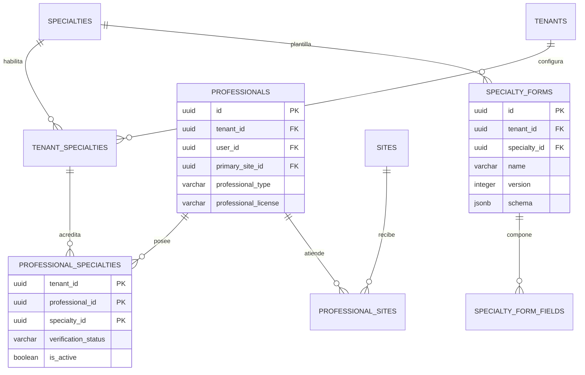

Reglas destacadas:

- `professional_specialties` referencia `tenant_specialties`, no el catálogo global: no se puede atender una especialidad no habilitada.
- Los formularios clínicos son versionados y pueden ser plantilla global o personalización del tenant.
- Un profesional solo puede tener una sede principal (`is_primary` único por profesional).

## 5. Pacientes

El paciente pertenece a un tenant. Se admiten identificadores múltiples, contactos, direcciones, familiares, alertas, consentimientos y solicitudes de datos personales.

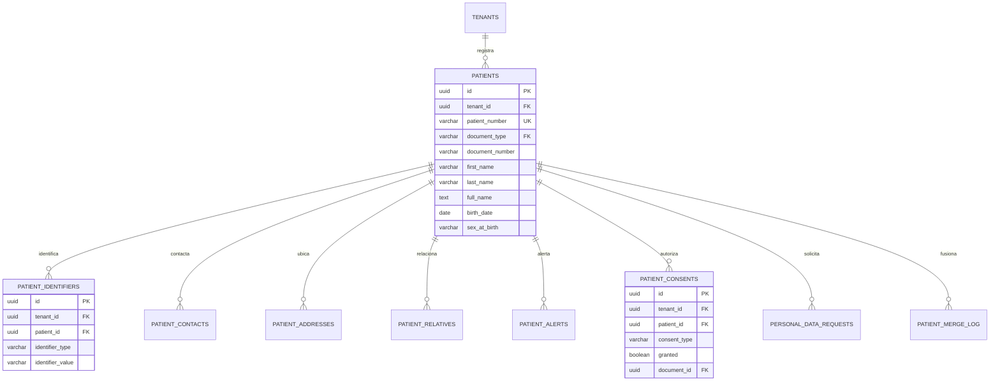

Reglas destacadas:

- Documento único por tenant y tipo, solo cuando el número no es nulo.
- `full_name` es una columna generada y tiene índice trigram para búsqueda.
- `patient_consents` exige `granted_at` cuando el consentimiento está otorgado y controla la revocación.
- `patient_merge_log` conserva la trazabilidad de fusiones sin borrar los registros originales.
- La historia clínica es longitudinal y única por paciente (`clinical_records`).

## 6. Catálogos clínicos

Catálogos globales compartidos por todos los tenants. CIE-10, CUPS e IUM se cargan completos desde SISPRO; los exámenes de laboratorio son un catálogo operativo de ejemplo.

| Tabla | Contenido |
| --- | --- |
| `diagnosis_catalog` | CIE-10 |
| `procedure_catalog` | CUPS / procedimientos |
| `medication_catalog` | Medicamentos y presentaciones |
| `laboratory_tests` | Exámenes de laboratorio |
| `document_types` | Tipos de documento de identidad |
| `document_categories` | Categorías documentales (globales o por tenant) |
| `clinical_note_types` | Tipos de nota clínica |
| `insurers` | EPS, ARL, prepagadas y complementarios |

## 7. Agendamiento

La agenda se compone de tipos de cita, agendas por profesional y sede, reglas de disponibilidad recurrentes, excepciones y citas. Las citas se protegen con restricciones de exclusión GiST.

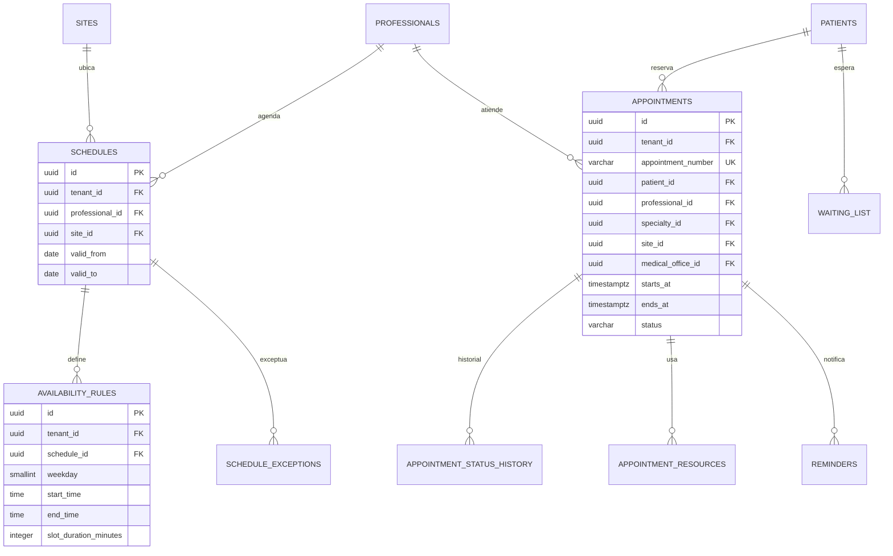

Reglas destacadas:

- Exclusión GiST por profesional: no puede haber dos citas activas solapadas.
- Exclusión GiST por consultorio: no puede haber dos citas activas en el mismo consultorio.
- Solo los estados `PENDING`, `CONFIRMED`, `RESCHEDULED`, `WAITING` e `IN_PROGRESS` participan de la exclusión; canceladas y atendidas liberan el horario.
- `appointment_resources` tiene su propia exclusión GiST por recurso.
- Cada cambio de estado genera una fila en `appointment_status_history` mediante trigger.
- `waiting_list` y `reminders` completan el flujo operativo.

## 8. Historia clínica

El expediente se compone de encuentros, notas versionadas, adendas, antecedentes, alergias, signos vitales, diagnósticos, órdenes, medicamentos y fórmulas.

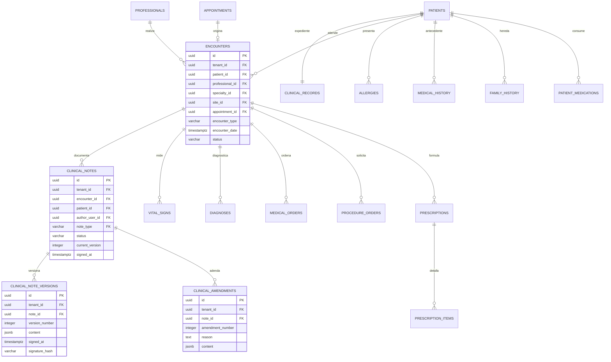

Ciclo de vida de la nota:

```text
DRAFT ──firma──> SIGNED ──adenda──> AMENDED
  │                 │
  └──descarte──> VOID
```

Reglas destacadas:

- Las versiones y adendas son inmutables (`prevent_mutation`).
- No se puede registrar una versión nueva si la nota ya está firmada; se debe usar una adenda.
- La firma exige al menos una versión con `signed_at`; el trigger completa `signed_at` y `signed_by`.
- No se puede eliminar una nota firmada o adendada.
- `current_version` se mantiene por trigger al insertar versiones.
- Los diagnósticos referencian CIE-10 y los procedimientos CUPS.
- Las fórmulas tienen numeración (`R…`) y sus ítems son hijos inmutables por auditoría.

## 9. Documentos

Los archivos viven en almacenamiento privado compatible con S3. La base conserva metadatos, versiones, permisos granulares y firmas.

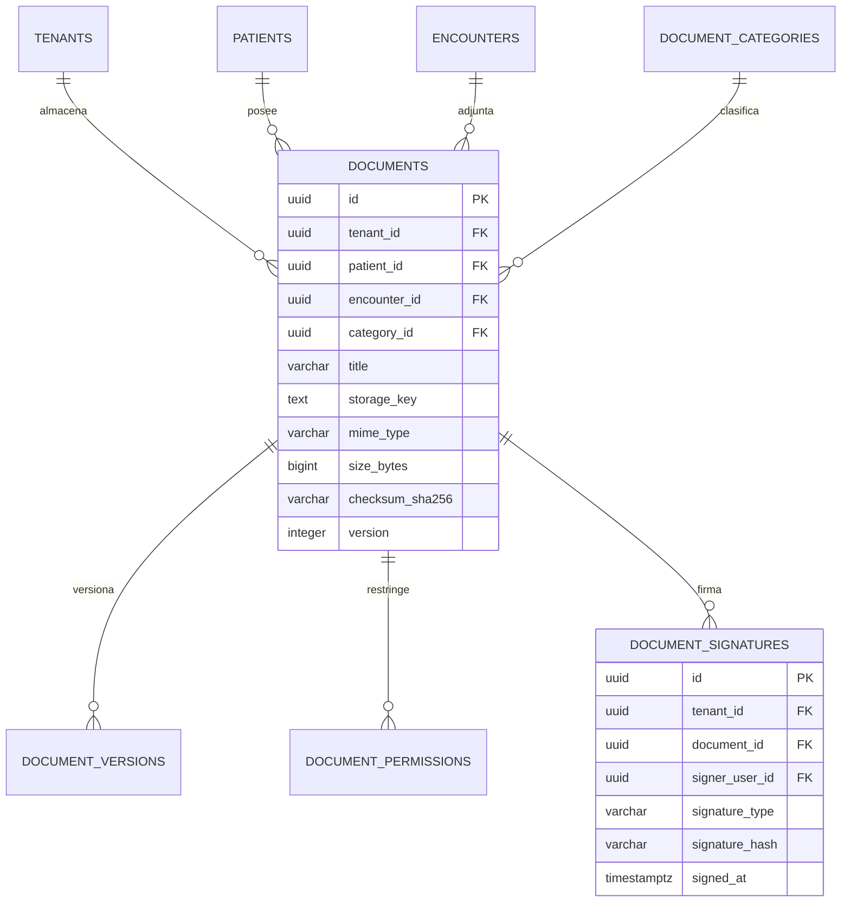

Reglas destacadas:

- `storage_key` nunca es una URL pública; el backend genera URLs firmadas de corta duración.
- Los permisos pueden otorgarse a usuarios o roles, con expiración.
- Las firmas son inmutables y guardan hash, certificado y metadatos.
- `patient_consents`, `prescriptions`, `diagnostic_reports` y `rda_documents` referencian documentos.

## 10. Laboratorio

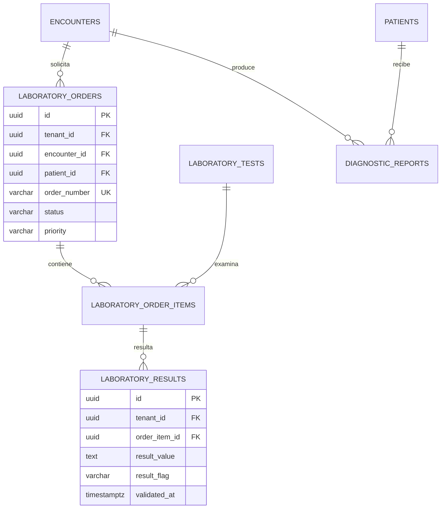

Reglas destacadas:

- Flujo de orden: `REQUESTED → COLLECTED → IN_PROCESS → RESULTED → VALIDATED`, con cancelación.
- Los resultados guardan rango de referencia y bandera (`NORMAL`, `HIGH`, `LOW`, `CRITICAL`, `ABNORMAL`).
- Los reportes diagnósticos pueden ser de laboratorio, imagen, patología o cardiología.

## 11. Facturación y EPS

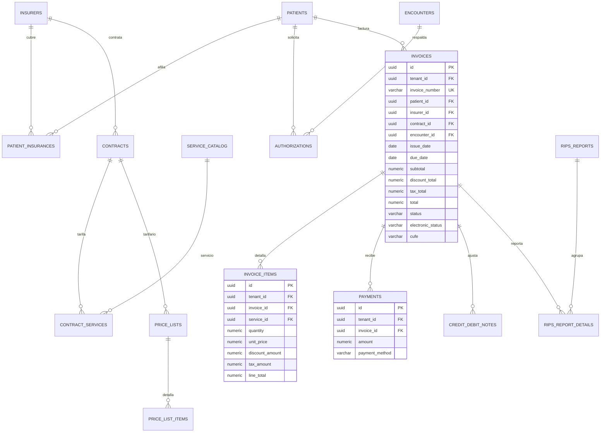

Reglas destacadas:

- `invoice_items.line_total` es columna generada.
- Un trigger recalcula `subtotal`, `discount_total`, `tax_total` y `total` en cada cambio de ítem.
- `total = subtotal - discount_total + tax_total` se valida con `CHECK`.
- La vista `sigm.v_accounts_receivable` calcula pagos, saldo y estado de cartera con `security_invoker = true`, por lo que respeta RLS.
- `electronic_status` y `cufe` soportan facturación electrónica DIAN.
- RIPS se modela como cabecera y detalles con `payload` y errores de validación.

## 12. Interoperabilidad

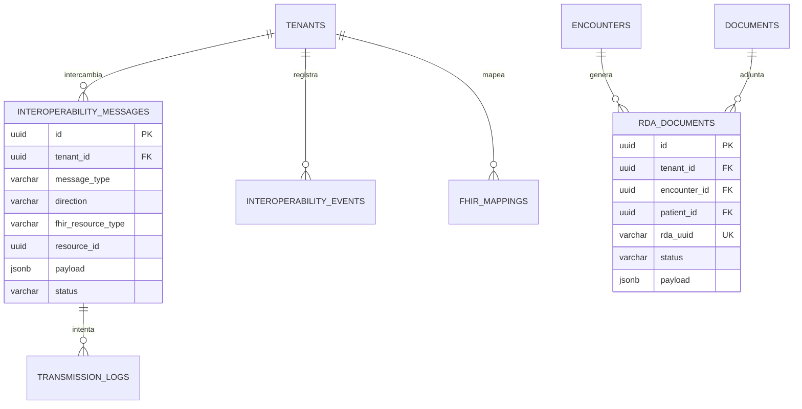

Reglas destacadas:

- Los mensajes conservan el payload enviado y la respuesta, para trazabilidad.
- `fhir_mappings` puede ser global o por tenant.
- `rda_documents` materializa el Resumen Digital de Atención (Res. 1888 de 2025).
- Los reintentos quedan en `transmission_logs`.

## 13. Auditoría y seguridad

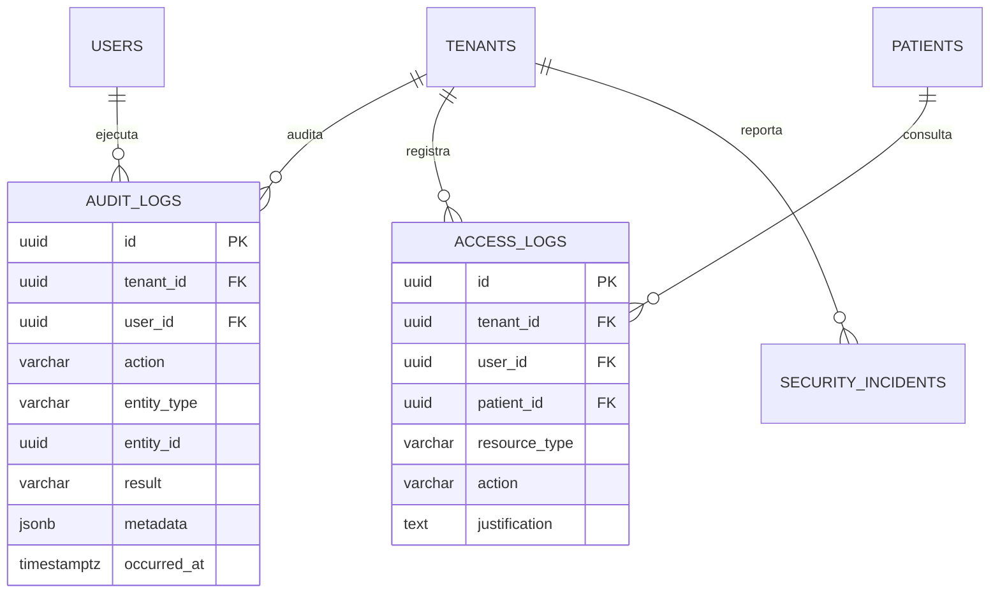

Reglas destacadas:

- `audit_logs` y `access_logs` son append-only.
- El trigger de auditoría es `SECURITY DEFINER` y no se concede a `sigm_app`.
- `access_logs` registra vistas, descargas, impresiones, exportaciones y comparticiones de información clínica.
- `security_incidents` soporta la gestión de incidentes de la Ley 1581.

## Inventario completo de tablas

### Tenancy y suscripciones
`tenants`, `plans`, `tenant_subscriptions`, `tenant_features`, `tenant_settings`, `tenant_domains`, `tenant_branding`, `subscription_payments`.

### Organización y recursos
`organizations`, `sites`, `departments`, `medical_offices`, `resources`.

### Identidad y acceso
`users`, `roles`, `permissions`, `role_permissions`, `user_tenants`, `user_roles`, `user_sessions`, `authentication_events`.

### Especialidades y profesionales
`specialties`, `tenant_specialties`, `professionals`, `professional_sites`, `professional_specialties`, `specialty_forms`, `specialty_form_fields`.

### Pacientes
`document_types`, `patients`, `patient_identifiers`, `patient_contacts`, `patient_addresses`, `patient_relatives`, `patient_alerts`, `patient_consents`, `personal_data_requests`, `patient_merge_log`.

### Catálogos clínicos
`diagnosis_catalog`, `procedure_catalog`, `medication_catalog`, `laboratory_tests`, `document_categories`, `clinical_note_types`, `insurers`.

### Agendamiento
`appointment_types`, `schedules`, `availability_rules`, `schedule_exceptions`, `appointments`, `appointment_status_history`, `appointment_resources`, `waiting_list`, `reminders`.

### Historia clínica
`clinical_records`, `encounters`, `clinical_notes`, `clinical_note_versions`, `clinical_amendments`, `medical_history`, `family_history`, `allergies`, `vital_signs`, `diagnoses`, `medical_orders`, `procedure_orders`, `patient_medications`, `prescriptions`, `prescription_items`.

### Documentos
`documents`, `document_versions`, `document_permissions`, `document_signatures`.

### Laboratorio
`laboratory_orders`, `laboratory_order_items`, `laboratory_results`, `diagnostic_reports`.

### Facturación y EPS
`patient_insurances`, `contracts`, `service_catalog`, `price_lists`, `price_list_items`, `contract_services`, `authorizations`, `invoices`, `invoice_items`, `payments`, `credit_debit_notes`, `rips_reports`, `rips_report_details`.

### Interoperabilidad
`interoperability_messages`, `interoperability_events`, `fhir_mappings`, `transmission_logs`, `rda_documents`.

### Auditoría y seguridad
`audit_logs`, `access_logs`, `security_incidents`.

## Relaciones transversales

| Relación | Mecanismo |
| --- | --- |
| Aislamiento por tenant | `tenant_id` + FK compuesta + RLS `FORCE` |
| Autoría y responsable | FK a `user_tenants (tenant_id, user_id)` |
| Evidencia clínica | Versiones y adendas inmutables + auditoría |
| Agenda sin doble reserva | Restricciones de exclusión GiST |
| Totales financieros | Trigger + columnas generadas + `CHECK` |
| Archivos | Metadatos en base, contenido en almacenamiento privado |
| Interoperabilidad | Payload JSON + mapeos FHIR + logs de transmisión |
| Cumplimiento | Auditoría append-only + consentimientos + solicitudes de datos |
